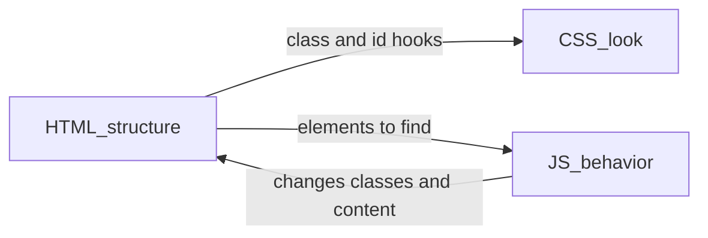
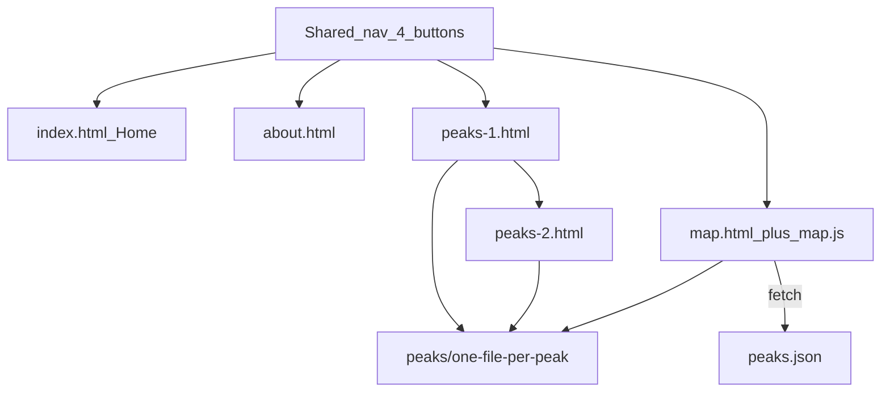

# Olympus Mons: learn frontend while shipping the site

You already have `[C:\Users\Admin\Desktop\Peak Hunter](C:\Users\Admin\Desktop\Peak Hunter)` with git remote [https://github.com/alyyyyyanna/Peak-Hunter.git](https://github.com/alyyyyyanna/Peak-Hunter.git). The only page so far is an empty `[about.html](C:\Users\Admin\Desktop\Peak Hunter\about.html)`. Photos can wait; names (and coords when you have them) go in `peaks.json`.

You have already used Leaflet in `[Desktop/Jeepney Router](C:\Users\Admin\Desktop\Jeepney Router)` — the Map page is the same idea, reused for hiking peaks.

When this plan is approved, the first implementation step is to move the workspace into that folder **before** any files are added.

## How HTML, CSS, and JS work together

Think of three jobs, not three “languages you mix randomly”:




- **HTML** is the skeleton: headings, nav, buttons, a `<div id="map">`. It answers “what is on the page?”
- **CSS** (`style.css`) is the look: layout, colors, nav in the top-right, slideshow. It answers “how does it look?”
- **JavaScript** is the behavior: dropdown → move the Leaflet marker, slideshow, optional gallery. It answers “what happens when I click?”

A typical page will look like this:

```html
<link rel="stylesheet" href="style.css">          <!-- your look -->
<link rel="stylesheet" href="https://unpkg.com/leaflet@1.9.4/dist/leaflet.css">
...
<nav><!-- 4 buttons: Home About Peaks Map --></nav>
<div id="map"></div>
<script src="https://unpkg.com/leaflet@1.9.4/dist/leaflet.js"></script>
<script src="map.js"></script>                     <!-- your behavior -->
```

**Rule that matters for GitHub Pages:** use relative paths (`style.css`, `images/foo.jpg`, `peaks/osmena.html`), never `/style.css`. A leading `/` breaks the site at `https://alyyyyyanna.github.io/Peak-Hunter/`.

## Optional: interactive photo, panorama, or 3D view

This is possible, but effort depends on the source:

- **Zoomable photo:** easiest. A high-resolution image can be displayed with an image-zoom viewer; it remains a flat image.
- **360° panorama:** a practical next step. A viewer such as Pannellum provides drag-to-look and zoom, but you need a 360° photo (often stitched from multiple shots). A regular photo cannot show the surroundings outside its frame.
- **True 3D from photos/video:** considerably harder. It generally requires many overlapping photos or video frames, photogrammetry software, model cleanup, and export to a web format such as `.glb`. One picture alone cannot recreate a complete, accurate 3D scene. Models may also be large and slow on phones.

Keep this optional until the static pages and map are working. Start by adding a zoomable image or panorama to one peak detail page. If you later have a 3D model, a web component such as `<model-viewer>` can embed it; check its size and mobile performance. This is separate from the Leaflet overview map.

Shared data lives in `peaks.json` (name, lat, lng, image path, detail URL). The Map page **fetches** that file so you do not copy 16 coordinates into 16 HTML files by hand.




## File layout (from your PDF, plus a little JS)

```
Olympus Mons/
  index.html          Home (hero + slideshow later)
  about.html          Motive, process, links
  peaks-1.html        Peaks 1–8
  peaks-2.html        Peaks 9–16
  map.html            Overview map + dropdown
  map.js              Dropdown, marker, preview image, info link
  peaks.json          Shared peak data
  style.css           Shared look
  peaks/
    osmena-peak.html  (template copied 16 times; rename per peak)
  images/             Photos when ready; placeholders until then
```

Keep Home and About as **two files** so the four nav buttons match the spec. Copy the same `<nav>` into every page at first (easier to learn than a framework). Later you can extract it if you want.

Write **one** peak detail page until it looks right, then duplicate it 15 times and only change the title, text, image, and a tiny Leaflet map centered on that peak.

## How you will write code (process, not magic)

Each 2-hour session: one small visible win, then commit.

1. HTML first — ugly but clickable links between pages.
2. CSS second — shared nav, then one page’s layout.
3. JS last — only where HTML cannot do it (map dropdown, slideshow).
4. Open the file in the browser (`index.html`). Refresh after every change.
5. When Map `fetch` of `peaks.json` fails from `file://`, use a tiny local server (`npx serve` or Live Server). GitHub Pages serves over `https`, so fetch will work there.

**Best first change:** `index.html` + `style.css` with a top-right nav of four links. Everything else hangs off that.

You already know Leaflet from Jeepney Router: CDN CSS + JS, a map `div`, `L.map()`, `L.marker()`. Olympus Mons’s Map page adds: load `peaks.json`, a `<select>` of 16 names, on change fly to that marker and show its image; the ℹ button is just `<a href="peaks/...">`.

## GitHub website (Pages)

Repo is already on GitHub. After the first real pages exist:

1. GitHub → Peak-Hunter → Settings → Pages → Deploy from branch `main` / root (or `/docs` if you prefer; **root is simpler**).
2. Site URL will be `https://alyyyyyanna.github.io/Peak-Hunter/`.
3. Optional: in Pages, set the homepage; `index.html` is used automatically.

No Node build, no React. Static files only.

## Timeline (~2 hrs/day, ~15 hrs/week)

Assume 7 sessions of ~2 hours = **one week**. Target: **live v1 in 3 weeks** (~45 hours). Photos can be placeholders until week 3–4.

### Week 1 — Structure and look (15h)


| Session | Focus                                                                                                                                            |
| ------- | ------------------------------------------------------------------------------------------------------------------------------------------------ |
| 1–2     | HTML skeleton: `index.html`, `about.html`, empty `peaks-1/2.html`, `map.html`, identical nav. Open locally. Confirm every button switches pages. |
| 3–4     | `style.css`: layout, fonts, colors, sticky/top-right nav, Home hero.                                                                             |
| 5       | About copy: motive, process, documentation, GitHub link.                                                                                         |
| 6–7     | Home extras: title, short intro; optional CSS-only image strip (even with placeholders). Commit. Push.                                           |


**Checkpoint:** a real website with 4 working pages, still no map JS.

### Week 2 — Peaks content (15h)


| Session | Focus                                                                                                                            |
| ------- | -------------------------------------------------------------------------------------------------------------------------------- |
| 1       | `peaks.json`: 16 names, lat/lng if you have them, image filename, detail URL.                                                    |
| 2–3     | `peaks-1.html` / `peaks-2.html`: 8 cards each (image, name, ℹ → detail).                                                         |
| 4–6     | One detail template (`peaks/example-peak.html`): gallery slot, text, mini Leaflet map. Duplicate to 16 pages; fill names/coords. |
| 7       | Wire every ℹ button. Placeholder images OK.                                                                                      |


**Checkpoint:** you can click Home → Peaks → a named peak page.

### Week 3 — Map, JS, launch (15h)


| Session | Focus                                                                                                                                  |
| ------- | -------------------------------------------------------------------------------------------------------------------------------------- |
| 1–3     | `map.js`: Leaflet Cebu view, fetch `peaks.json`, dropdown, fly to marker, preview image, ℹ link. Reuse Jeepney Router Leaflet pattern. |
| 4       | GitHub Pages on; fix relative paths; test the live URL.                                                                                |
| 5–6     | Polish: missing-image fallbacks, mobile nav, About “how we built this”.                                                                |
| 7       | Buffer: bugs, README, screenshot for GitHub.                                                                                           |


**Checkpoint:** live GitHub site: Home, About, two Peaks pages, Map dropdown, 16 detail pages.

### Week 4 (optional, if photos/time)

Galleries, Home slideshow, compress maps on detail pages, better About documentation — matching the later ideas in the PDF.

## What we will not do at the start

- No React/Vite until this static version is live (the PDF stack is the right teacher).
- No combining Home+About into one file unless you later want fewer pages.
- No waiting for all 16 photos before coding.

## After you approve

1. Move the agent into `C:\Users\Admin\Desktop\Peak Hunter`.
2. Session 1 together: `index.html` + `style.css` + shared nav + stub pages so the four buttons work.
3. You fill peak names into `peaks.json` as soon as you have the list.

